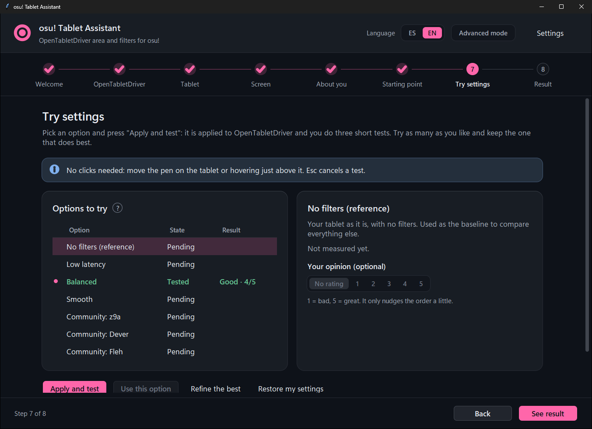

# osu-open-tablet

[Español](README.md)

> There is no download yet. The program is being tested and will get a Windows executable later.
> Until then you can try it from the source: see [Status and how to try it today](#status-and-how-to-try-it-today).

A Windows program that helps you set up [OpenTabletDriver](https://opentabletdriver.net) for osu!: the size
and position of the tablet area and the smoothing filters. OpenTabletDriver is a free, open-source tablet
driver used instead of the manufacturer's driver.

## What it does

When it opens you pick one of three paths:

- **Guided setup.** You answer a few questions and do short pen tests. The program tries several setups,
  measures them and recommends one, with the reason for each change. Each test takes 5 to 8 seconds (the aim
  test, as long as you take to pass over the circles) after a 3-second countdown, and each option is measured
  with three tests.
- **Live tuning.** With osu! open you ask for "smoother", "more responsive" or a bigger area with hotkeys and
  feel it right away. It takes as long as you like.
- **Play coach.** You play a normal map; the coach tells you where you fall short (corners, edges, long jumps)
  and proposes one change per round. Each round is one map.

Before the first change it backs up your OpenTabletDriver settings, it asks before applying anything, and
"Restore my original settings" takes you back.

## What about osu!'s rules?

The program only changes OpenTabletDriver settings (area and smoothing filters), the same as you could do by
hand. It does not read osu!'s memory, does not send clicks or movement to the game, and never turns on
prediction or plugins that assist input. Still, [osu!'s rules](https://osu.ppy.sh/wiki/Rules) and
[osu!'s notice about OpenTabletDriver plugins](https://osu.ppy.sh/community/forums/topics/2254092) are what
counts: if you are unsure about a plugin, check there.

## Status and how to try it today

This is a test version (0.9.x).

- No executable has been published yet. When there is one, it will be on this repository's Releases page.
- No tablet has been tried with this program on a real machine yet. The built-in list (48 Wacom, XP-Pen,
  Huion, Gaomon and VEIKK models) has its sizes checked against OpenTabletDriver's files; any other tablet
  OpenTabletDriver supports can be used by typing its size.
- Live apply is written from OpenTabletDriver's source but has not been checked with real hardware either.

You need Windows 10 or 11, OpenTabletDriver 0.6.x and [Python](https://www.python.org/downloads/) 3.10 or
later (the normal installer includes everything needed).

1. On this page, "Code", then "Download ZIP". Unzip it.
2. Double-click `run.bat`.

To look around without changing anything, open a console in that folder and run
`py -3 -m osu_tablet_assistant --dry-run`: nothing is applied to OpenTabletDriver.

To build an `.exe` yourself, see [CONTRIBUTING.md](CONTRIBUTING.md#compilar-el-exe) (in Spanish).
Problems: open an [issue](https://github.com/leonardoulysses92-star/Osu-Open-Tablet/issues).

## Docs

- In English: [play coach](docs/PLAY_COACH.md), [live tuning](docs/COMPANION.md),
  [interface design](docs/DESIGN.md), [architecture](docs/ARCHITECTURE.md).
- In Spanish: [usage guide](docs/guia.md), [community data](docs/comunidad.md), [filters](docs/filtros.md),
  [version history](CHANGELOG.md), [contributing](CONTRIBUTING.md).

## License

[MIT](LICENSE)
