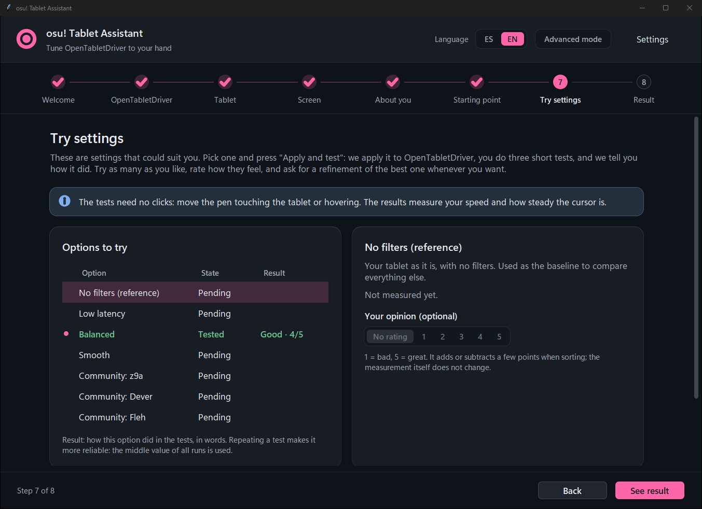

# osu-open-tablet

[Español](README.md) is the main README; this is a short summary.

A desktop assistant (Tkinter) that helps configure [OpenTabletDriver](https://opentabletdriver.net) (OTD) for osu!: tablet area, aspect ratio and smoothing filters. It works with any tablet OTD supports.

It measures the pen with four short tests, generates several candidate configurations, tries them one by one and recommends the best one, with a reason for every change. It also compares against configurations published by top players, with source and date.



Three ways in: a guided setup, live tuning while you play (companion), and the **play coach**, which watches a real play, tells you in plain words where you fall short (corners, top/bottom, sides) and proposes one change per round until little is left to gain. Your click buttons are configurable (default Z and X; the pen tip does not count unless you choose it).

Early stage (0.8.x). The live-apply path (OTD Console and daemon pipe) is written from OTD's source and has not been verified on real hardware.

## Download and try it

1. Go to [Releases](https://github.com/leonardoulysses92-star/Osu-Open-Tablet/releases/latest) and download `Osu-Open-Tablet-vX.Y.Z.exe`.
2. Double-click it. No Python or installer needed; you only need [OpenTabletDriver](https://opentabletdriver.net) 0.6.x.
3. To look around without touching your settings, start the `.exe` from a console with `--dry-run`: it applies nothing to OpenTabletDriver.

Windows may warn "Windows protected your PC" because the program is **not code-signed**. Click "More info" and "Run anyway" only if you
downloaded the file from this page. Every release lists its SHA-256 in the notes (`Get-FileHash file.exe`). If you would rather not run
the `.exe`, run the source with Python or build it yourself (see "Run" below): it is the same code as this repository.

This is an early version, not verified with every tablet or osu! build. A backup of your settings is made before any change.
Problems: open an [issue](https://github.com/leonardoulysses92-star/Osu-Open-Tablet/issues).

## Requirements

- Windows 10 or 11. Linux and macOS are untested.
- Python 3.10+ with `tkinter`. No `pip` dependencies.
- OpenTabletDriver 0.6.x, installed or portable. 0.6.8.1 or later is preferable on Windows when using interpolators.

## Run

```
py -3 -m osu_tablet_assistant
```

Or double-click `run.bat`. Options: `--lang es|en`, `--config-dir PATH`, `--install-dir PATH`, `--dry-run` (never applies anything to OTD).

For a standalone `.exe`: `powershell -ExecutionPolicy Bypass -File build_exe.ps1` (needs PyInstaller).

## Safety

A backup of `settings.json` is written to `<config>\Backup\` before the first change of each session, every change asks for confirmation, and `--dry-run` does not touch OTD. It never closes or restarts OTD and never installs plugins.

## Tests

```
py -3 -m unittest discover -s tests
```

## Docs

[Architecture](docs/ARCHITECTURE.md), [companion (live-tuning) mode](docs/COMPANION.md), [play coach](docs/PLAY_COACH.md), [design notes](docs/DESIGN.md) (all English) and [research notes](docs/research/). The usage guide, community data and filter catalog ([guia](docs/guia.md), [comunidad](docs/comunidad.md), [filtros](docs/filtros.md)) are in Spanish.

Version history: [CHANGELOG.md](CHANGELOG.md) (older versions are Git tags, see `git tag`). Want to help? See [CONTRIBUTING.md](CONTRIBUTING.md) (in Spanish; the short version: stdlib only, run `py -3 -m unittest discover -s tests`, keep es/en texts in sync).

## License

[MIT](LICENSE)
