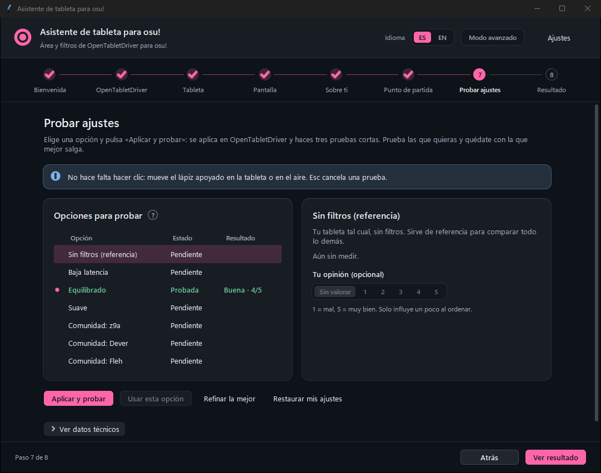

# osu-open-tablet

[English](README.en.md)

> Todavía no hay descarga. El programa está en pruebas y más adelante tendrá un ejecutable para Windows.
> Mientras tanto se puede probar desde el código: ver [Estado y cómo probarlo hoy](#estado-y-cómo-probarlo-hoy).

Un programa para Windows que te ayuda a configurar [OpenTabletDriver](https://opentabletdriver.net) para
osu!: el tamaño y la posición del área y los filtros de suavizado. OpenTabletDriver es un driver de tableta
gratuito y de código abierto que se usa en lugar del driver del fabricante.

## Qué hace

Al abrirlo eliges uno de tres caminos:

- **Configuración guiada.** Respondes unas preguntas y haces pruebas cortas con el lápiz. El programa prueba
  varias configuraciones, las mide y te recomienda una, con el motivo de cada cambio. Cada prueba dura entre
  5 y 8 segundos (la de puntería, lo que tardes en pasar por los círculos) tras una cuenta atrás de 3, y cada
  opción se mide con tres pruebas.
- **Ajuste en vivo.** Con osu! abierto pides "más suave", "más rápido" o un área más grande con atajos de
  teclado, y lo notas en el momento. Dura lo que tú quieras.
- **Coach de partidas.** Juegas un mapa normal; el coach te dice dónde te quedas corto (esquinas, bordes,
  saltos largos) y propone un solo cambio por ronda. Cada ronda es un mapa.

Antes del primer cambio guarda una copia de tu configuración de OpenTabletDriver, pide confirmación antes de
aplicar nada y puedes volver atrás con "Restaurar mis ajustes originales".

## ¿Y las normas de osu!?

El programa solo cambia ajustes de OpenTabletDriver (área y filtros de suavizado), lo mismo que podrías hacer
tú a mano. No lee la memoria de osu!, no envía clics ni movimientos al juego, y nunca activa la predicción
ni plugins que asistan la entrada. Aun así, mandan las [reglas de osu!](https://osu.ppy.sh/wiki/Rules) y el
[aviso de osu! sobre plugins de OpenTabletDriver](https://osu.ppy.sh/community/forums/topics/2254092): si
dudas de un plugin, consulta ahí. Más detalle en [docs/filtros.md](docs/filtros.md).

## Estado y cómo probarlo hoy

Es una versión de pruebas (0.9.x).

- No hay ejecutable publicado todavía. Cuando lo haya, estará en la página de Releases de este repositorio.
- Ninguna tableta se ha probado aún con este programa en un equipo real. La lista que trae (48 modelos de
  Wacom, XP-Pen, Huion, Gaomon y VEIKK) tiene las medidas comprobadas con los archivos de OpenTabletDriver;
  cualquier otra tableta que OpenTabletDriver soporte se puede usar escribiendo sus medidas.
- Aplicar ajustes en vivo está hecho a partir del código de OpenTabletDriver, pero tampoco se ha comprobado
  con hardware real.

Para probarlo necesitas Windows 10 u 11, OpenTabletDriver 0.6.x y
[Python](https://www.python.org/downloads/) 3.10 o posterior (el instalador normal ya incluye lo necesario).

1. En esta página, botón "Code" y luego "Download ZIP". Descomprímelo.
2. Doble clic en `run.bat`.

Si quieres mirar sin tocar nada, abre una consola en esa carpeta y escribe
`py -3 -m osu_tablet_assistant --dry-run`: así no se aplica nada a OpenTabletDriver.

Si prefieres un `.exe`, puedes compilarlo tú siguiendo [CONTRIBUTING.md](CONTRIBUTING.md#compilar-el-exe).
Si algo falla, abre una [incidencia](https://github.com/leonardoulysses92-star/Osu-Open-Tablet/issues).

Con interpoladores en Windows conviene OpenTabletDriver 0.6.8.1 o posterior; con versiones anteriores el
programa avisa, pero no obliga a actualizar.

## Documentación

- [Guía de uso](docs/guia.md): los pasos, las pruebas, dónde se guarda cada archivo y cómo deshacer.
- [Datos de la comunidad](docs/comunidad.md): de dónde salen y cómo se adaptan a tu área.
- [Filtros](docs/filtros.md): qué filtros se recomiendan y las normas de osu! sobre predicción.
- [Coach de partidas](docs/PLAY_COACH.md) y [ajuste en vivo](docs/COMPANION.md) (en inglés).
- [Historial de versiones](CHANGELOG.md).
- [Cómo colaborar](CONTRIBUTING.md): código, tests y cómo compilar.

## Licencia

[MIT](LICENSE)
