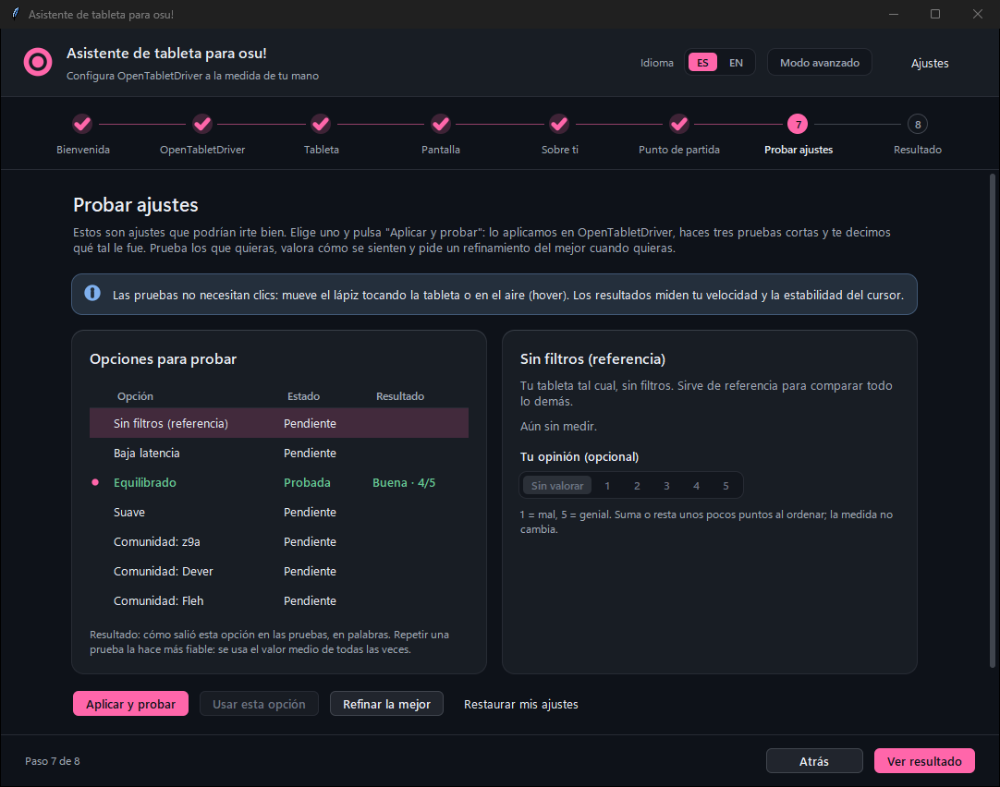

# osu-open-tablet

[English](README.en.md)

Asistente de escritorio (Tkinter) para configurar [OpenTabletDriver](https://opentabletdriver.net) (OTD) al jugar osu!: tamaño y proporción del área, y filtros de suavizado. Sirve para cualquier tableta que OTD soporte.

Mide el lápiz con cuatro pruebas cortas, genera varias configuraciones candidatas, las prueba una por una y recomienda la que mejor sale, con el motivo de cada cambio. También compara con configuraciones publicadas por jugadores del top, con su fuente y fecha.



Tres caminos: **configuración guiada**, **ajuste en vivo** mientras juegas (acompañante) y **coach de partidas**: juegas un mapa de verdad y el coach te dice en palabras sencillas dónde te quedas corto (esquinas, arriba/abajo, laterales) y propone **un** cambio por ronda hasta que ya no queda nada por ganar. Tus botones de clic son configurables (por defecto Z y X; la punta del lápiz no cuenta salvo que la elijas).

Está en una fase temprana (0.1.x). Ver [Estado](#estado).

## Requisitos

- Windows 10 u 11. Linux y macOS no están probados.
- Python 3.10 o superior con `tkinter`. No hay dependencias de `pip`.
- OpenTabletDriver 0.6.x, instalado o portable. Con interpoladores en Windows conviene la 0.6.8.1 o posterior; con la 0.6.7 el asistente avisa y no te obliga a actualizar.

## Uso

```
py -3 -m osu_tablet_assistant
```

O doble clic en `run.bat`. Opciones:

| Opción | Efecto |
|---|---|
| `--lang es\|en` | Idioma de la interfaz. Por defecto, el último usado. |
| `--config-dir RUTA` | Carpeta de configuración de OTD (la que tiene `settings.json`). |
| `--install-dir RUTA` | Carpeta del programa de OTD (la que tiene `OpenTabletDriver.Daemon.exe`). |
| `--dry-run` | No aplica nada a OTD. Solo permite guardar el archivo y el informe. |

Para un ejecutable sin Python: `powershell -ExecutionPolicy Bypass -File build_exe.ps1` (requiere PyInstaller). Genera `dist\Osu Open Tablet.exe`.

## Cómo funciona

1. Localiza OTD y lee tus perfiles y plugins.
2. Eliges tableta y pantalla, y respondes unas preguntas (estilo de juego, mapas, prioridad, plugins permitidos).
3. Mide tu punto de partida: tasa de reporte y estabilidad.
4. Aplica cada candidata a OTD, la mide (estabilidad, seguimiento, puntería) y te dice cómo salió en palabras (Excelente, Buena, Normal o Floja); repetir una prueba la hace más fiable. Puedes refinar la mejor.
5. Te muestra la recomendación con los motivos, las mediciones y la comparación con la comunidad. La guardas como archivo de OTD o la aplicas.

El detalle de cada paso, las pruebas y dónde se guarda cada archivo está en [docs/guia.md](docs/guia.md).

## Seguridad

- Copia de `settings.json` en `<config>\Backup\` antes del primer cambio de cada sesión.
- Pide confirmación antes de aplicar ajustes, restaurar o reemplazar un archivo.
- `--dry-run` no toca OTD.
- No cierra ni reinicia OTD, y nunca instala plugins: te dice cuál, por qué y dónde conseguirlo.
- No activa la predicción por su cuenta. Ver [docs/filtros.md](docs/filtros.md).

Para deshacer: "Restaurar mi configuración" en la app, cargar un archivo en OTD, o con OTD cerrado copiar la copia de `Backup\` encima de `settings.json`.

## Estructura

```
run.bat, build_exe.ps1
data/                    paquete de datos de la comunidad (generado)
tools/refresh_data.py    regenera data/
docs/                    documentación
osu_tablet_assistant/
  appconfig.py           ajustes del propio asistente
  otd/                   todo lo que toca OTD
  knowledge/             tabletas, catálogo de filtros, presets de la comunidad
  engine/                área, recomendaciones, métricas
  gui/                   asistente y pruebas en vivo
  locales/{es,en}/       textos de la interfaz
tests/                   unittest
```

## Documentación

- [Guía de uso](docs/guia.md): pasos, política de plugins, pruebas, archivos.
- [Datos de la comunidad](docs/comunidad.md): fuentes, adaptación al área, actualización.
- [Filtros](docs/filtros.md): catálogo y normas de osu! sobre predicción.
- [Modo acompañante](docs/COMPANION.md) (en inglés): ajuste en vivo mientras juegas.
- [Coach de partidas](docs/PLAY_COACH.md) (en inglés): qué ve, qué infiere y sus límites.
- [Diseño de la interfaz](docs/DESIGN.md) (en inglés): paleta, formas redondeadas y cómo ajustarlas.
- [Arquitectura](docs/ARCHITECTURE.md) y [notas de investigación](docs/research/).

## Tests

```
py -3 -m unittest discover -s tests
```

Los tests fallan si `data/` no está al día con `knowledge/`; se regenera con `python tools/refresh_data.py`.

## Estado

- La aplicación en vivo (Console y pipe del daemon) está escrita a partir del código de OTD y no se ha verificado con hardware real.
- El escalado por área de los valores de la comunidad es una heurística, no una regla de los autores de los plugins.
- La tasa de reporte de la tableta se escribe a mano. Solo se detecta el monitor principal.
- No está resuelto si los ajustes de predicción cuentan como asistencia de entrada para osu!.

## Licencia

[MIT](LICENSE)
